# SPOT — Guia atualizado de estudo e defesa

Versão técnica de 10/11/2026. Código: 146bd986867ecb25bc75db53c6d1944c6d89ae66.

Repositório: https://github.com/iamnotlittleprince/SPOT

## 1 INTRODUÇÃO

O sistema denominado Sistemas de Projetos, Organização e Tarefas (SPOT) é uma aplicação web desenvolvida no contexto do Curso de Informática do Colégio Dr. Clóvis Bevilacqua para apoiar necessidades de gestão relatadas no trabalho da Computécnica. O problema reúne organização de atividades, delimitação de responsabilidades, comunicação e acompanhamento dos custos de execução. A monografia preliminar registra a intenção de modernizar a experiência de uso e reduzir a dependência de soluções externas; a edição final descreve o que o código efetivamente demonstra (Longo et al., 2026b).

### 1.1 Problema de pesquisa

Como integrar o planejamento, a execução e o acompanhamento gerencial de projetos em uma aplicação web que preserve responsabilidades e restrições de acesso entre pessoas e equipes? A pergunta não pressupõe que uma nova interface, isoladamente, aumente a produtividade. A resposta é examinada pela especificação, implementação e verificação de comportamentos, e não por uma promessa de resultado financeiro.

### 1.2 Objetivo geral

Desenvolver e documentar uma aplicação integrada de projetos, organização e tarefas, com regras de identidade e autorização, execução rastreável e informações de apoio à gestão, verificando a implementação por testes reproduzíveis.

### 1.3 Objetivos específicos

Identificar necessidades na pesquisa documental e de campo; modelar entidades e responsabilidades; implementar autenticação, projetos, equipes, tarefas, horas e despesas; organizar comunicação, notificações e agenda; consolidar indicadores; disponibilizar recursos de idiomas e acessibilidade; verificar regras e interface; e registrar condições de implantação e continuidade.

### 1.4 Justificativa e delimitação

A contribuição é a tradução de necessidades operacionais em dados relacionados e regras verificáveis. Projetos precisam de responsáveis; comunicação fora de um time precisa de autorização; custos dependem de registros e tarifas. O produto busca coordenar esses elementos em um fluxo coerente. A pesquisa fornece contexto, mas não substitui avaliação posterior de uso.

O recorte técnico é o commit 146bd986867ecb25bc75db53c6d1944c6d89ae66, confirmado no repositório remoto em 10 de novembro de 2026. São descritos recursos presentes e verificados nessa revisão. Integrações que dependem de terceiros são distinguidas de homologação real; não se afirma implantação concluída nem conformidade integral de acessibilidade. O estudo de soluções e inteligência artificial (IA) é preservado como fundamentação, com atualização da relação entre propostas e entrega.

### 1.5 Organização do trabalho

O texto apresenta fundamentos e estudo de soluções, metodologia, pesquisa de campo, arquitetura, funcionalidades, modelo de dados, verificação, implantação e conclusão. Os apêndices permitem localizar rotas e migrations. As referências reúnem as fontes efetivamente consultadas, com acesso ao repositório e à versão do código.

## 2 FUNDAMENTAÇÃO E ESTUDO DE SOLUÇÕES

A fundamentação relaciona organização do trabalho, componentes de software e soluções consultadas. A distinção entre levantamento documental e validação prática delimita as conclusões possíveis.

### 2.1 Gestão integrada e rastreabilidade

A coordenação de projetos depende de informações consistentes sobre escopo, pessoas, prazos, execução e custos. Neste trabalho, integração significa relacionar esses registros e aplicar regras de acesso em suas operações. Uma visualização pode resumir dados, mas a coerência depende de sua origem, validação e atualização; por isso o desenho do sistema inclui histórico, auditoria e vinculação entre entidades.

### 2.2 Aplicações web, componentes e persistência

A separação entre componentes de interface e regras de servidor permite modificar apresentação sem deslocar decisões de segurança ao navegador. Rotas e validação no Laravel, componentes React e construção com Vite dão suporte a essa organização; o projeto relacional e o controle transacional mantêm os vínculos persistidos (Laravel, 2026; Meta Platforms, [20--]; PostgreSQL Global Development Group, 2026; Vite, [20--]).

### 2.3 Levantamento documental de sistemas

O estudo preliminar abrangeu ferramentas de gestão e serviços de infraestrutura. Nesta revisão, foram consultadas páginas oficiais para registrar a finalidade geral das soluções sem atribuir preços, superioridade ou desempenho não medidos. A descrição é documental; não houve ensaio comparativo controlado, contratação nem avaliação de todos os planos comerciais.

As informações correspondentes estão organizadas no Quadro 1.

Soluções consultadas e papel no estudo

| Solução | Aspecto observado | Fonte |
| --- | --- | --- |
| monday.com | Organização de trabalho, painéis e integrações | monday.com ([20--]) |
| Asana | Coordenação de trabalho e fluxos de equipe | Asana (2026) |
| Jira | Organização e acompanhamento de trabalho em equipes | Atlassian (2026a) |
| Trello | Quadros, organização de tarefas e automações | Atlassian (2026b) |
| ClickUp | Reunião de projetos, documentos e comunicação | ClickUp (2026) |
| Notion | Organização de conhecimento e trabalho | Notion (2026) |
| AWS | Infraestrutura e serviços de nuvem; não é equivalente direto a um gerenciador de tarefas | Amazon Web Services (2026) |

Fonte: Elaboração própria a partir das páginas oficiais indicadas nas referências, consultadas em 10 nov. 2026.

O SPOT não é apresentado como substituto universal dessas ferramentas. Sua contribuição é o ajuste das regras ao contexto estudado, com rastreabilidade entre cadastro, permissões, execução e finanças. O estudo de mercado orienta critérios de organização, sem sustentar comparação causal de qualidade ou custo.

### 2.4 Inteligência artificial, automação e tradução

O estudo original de tecnologias de IA não deve ser confundido com uma lista de recursos entregues. A implementação final utiliza regras determinísticas e processamento analítico; dispõe também de tradução automática opcional de mensagens por serviço configurado. Não foram demonstrados agentes generativos de planejamento, predição validada de custos ou decisões gerenciais autônomas. A categoria automação e IA da pesquisa continua preservada como sugestão, sem alteração do dado original (Longo et al., 2026a).

### 2.5 Acessibilidade e documentação

O desenho acessível considera modos distintos de interação e compreensão, tendo Web Content Accessibility Guidelines (WCAG) 2.2 AA como objetivo e avaliação humana como etapa necessária (World Wide Web Consortium, 2024). A organização deste texto utiliza as normas da Associação Brasileira de Normas Técnicas (ABNT) para apresentação, citações, referências, numeração, sumário e resumo (Associação Brasileira de Normas Técnicas, 2012a, 2012b, 2021, 2023, 2024, 2025), apoiadas pelas orientações institucionais de bibliotecas universitárias (Universidade Federal do ABC, [20--]; Universidade Federal do Espírito Santo, 2026).

## 3 METODOLOGIA

Os procedimentos distinguem dados de participantes, documentos e evidências de implementação. São apresentados os critérios de análise e os limites das fontes disponíveis.

### 3.1 Natureza e procedimentos

O trabalho reúne desenvolvimento aplicado de software, pesquisa descritiva com participantes e estudo documental. O levantamento com usuários foi recebido como fonte primária da equipe; o estudo de ferramentas foi confrontado com páginas oficiais; a implementação foi analisada por rotas, migrations, controladores, componentes, dependências e testes. A distinção entre essas fontes evita apresentar opinião de participante como resultado de uma medição de software.

### 3.2 Critério de versão e evidência

A revisão técnica utiliza o commit 146bd986867ecb25bc75db53c6d1944c6d89ae66 e evidências registradas em output/production-review. A documentação inclui inventário de rotas e manifesto das fontes. Um teste aprovado é tratado como evidência do cenário exercitado. Build, análise de dependências e smoke test de imagem são verificações diferentes e não equivalem a homologação completa (Longo et al., 2026c).

### 3.3 Cuidados éticos e limitações

Foram preservados os totais e as inconsistências documentais da pesquisa. Não houve reconstrução de respostas individuais nem criação de depoimentos. As capturas da aplicação empregam dados sintéticos e APIs simuladas, sem expor credenciais ou mensagens reais. Resultados financeiros, produtividade e satisfação pós-implantação não foram medidos, de modo que não se atribui ao produto um efeito que não foi observado.

## 4 LEVANTAMENTO DE PESQUISA DE CAMPO

O levantamento descreve percepções dos participantes e orienta a relação entre necessidades e requisitos. A apresentação mantém as frequências recuperáveis e registra as diferenças documentais.

### 4.1 Procedimento e base documental

O levantamento foi caracterizado no documento fornecido pela equipe como pesquisa aplicada, descritiva, quali-quantitativa, conduzida por formulário eletrônico entre 18 de março e 24 de agosto de 2026. O texto declara 15 questões fechadas, uma aberta e 94 respostas válidas. A amostra foi de conveniência, não probabilística; os resultados descrevem participantes e não permitem generalização estatística a todas as empresas (Longo et al., 2026a).

A edição final preserva as frequências recuperadas no capítulo da pesquisa e no arquivo dados_pesquisa.json. Não houve acesso à planilha individual de respostas. Treze conjuntos gráficos foram recuperados; o material não permite reconstruir todas as perguntas declaradas separadamente. Os totais de algumas figuras diferem de 94, sem indicação suficiente para distinguir não resposta, filtro ou erro documental.

Os percentuais desta edição usam 94 como base declarada, com uma casa decimal. Quando alternativas não são exclusivas, as frequências não devem somar o total de participantes. Nos demais casos, a diferença até 94 é explicitada como não discriminada e não é convertida em uma categoria inventada.

### 4.2 Resultados quantitativos

As distribuições a seguir correspondem aos treze conjuntos quantitativos recuperados. Tabelas e figuras mantêm as categorias publicadas e permitem conferir as frequências com a base declarada.

#### 4.2.1 Faixa etária

Os dados correspondentes constam da Tabela 1.

Faixa etária

| Alternativa | Frequência | % da base 94 |
| --- | --- | --- |
| 15 a 25 anos | 28 | 29,8% |
| 25 a 35 anos | 22 | 23,4% |
| 35 a 45 anos | 19 | 20,2% |
| 45 a 55 anos | 15 | 16,0% |
| Acima de 55 | 10 | 10,6% |

Fonte: Dados da pesquisa da equipe (Longo et al., 2026a); percentuais calculados nesta edição.

A representação correspondente é apresentada na Figura 1.

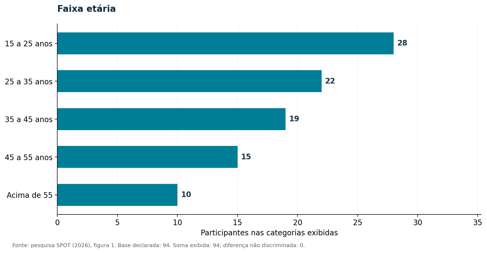

Fonte: Dados de Longo et al. (2026a), reconstituídos pela equipe; base declarada de 94 participantes.

As categorias exibidas somam os 94 participantes declarados. A distribuição permite discutir diversidade etária de uso; não mede habilidades digitais individuais nem autoriza definir uma interface para uma única faixa. O documento também informa 88 participantes empregados, equivalentes a 93,6% da base, sem detalhar os demais estados de emprego.

#### 4.2.2 Atuação em gestão de projetos

Os dados correspondentes constam da Tabela 2.

Atuação em gestão de projetos

| Alternativa | Frequência | % da base 94 |
| --- | --- | --- |
| Não atua | 65 | 69,1% |
| Atua parcialmente | 20 | 21,3% |
| Totalmente | 4 | 4,3% |
| Sim | 3 | 3,2% |

Fonte: Dados da pesquisa da equipe (Longo et al., 2026a); percentuais calculados nesta edição.

A representação correspondente é apresentada na Figura 2.

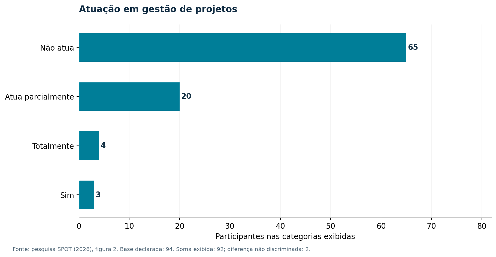

Fonte: Dados de Longo et al. (2026a), reconstituídos pela equipe; base declarada de 94 participantes.

As categorias exibidas somam 92; a diferença de 2 em relação à base de 94 não foi discriminada na fonte. A maioria das pessoas nas categorias exibidas não atua diretamente em gestão de projetos. Isso fundamenta a prioridade de linguagem clara e tutorial, mas não comprova que a interface final foi validada por esse grupo.

#### 4.2.3 Ferramentas utilizadas

Os dados correspondentes constam da Tabela 3.

Ferramentas utilizadas

| Alternativa | Frequência | % da base 94 |
| --- | --- | --- |
| Microsoft Office 365 | 52 | 55,3% |
| Software próprio | 26 | 27,7% |
| Microsoft Office 2021 | 19 | 20,2% |
| Nenhum software | 17 | 18,1% |
| Bloco de Notas | 16 | 17,0% |
| Notion | 4 | 4,3% |

Fonte: Dados da pesquisa da equipe (Longo et al., 2026a); percentuais calculados nesta edição.

A representação correspondente é apresentada na Figura 3.

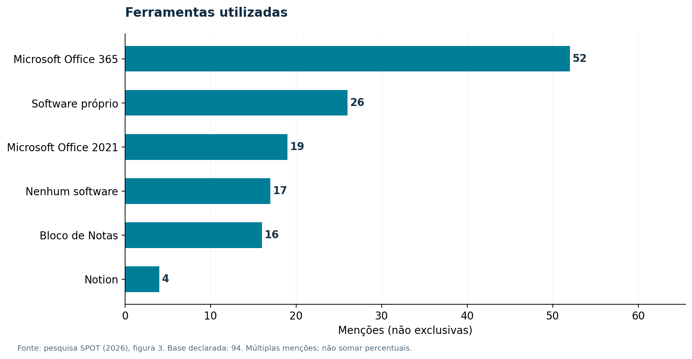

Fonte: Dados de Longo et al. (2026a), reconstituídos pela equipe; base declarada de 94 participantes.

As frequências são menções não exclusivas e somam 134. As menções indicam coexistência de ferramentas de escritório e soluções específicas. Trata-se de uma pergunta de menções não exclusivas; não há base para inferir migração integral dos participantes para o SPOT.

#### 4.2.4 Software de projetos na empresa

Os dados correspondentes constam da Tabela 4.

Software de projetos na empresa

| Alternativa | Frequência | % da base 94 |
| --- | --- | --- |
| Não possui | 33 | 35,1% |
| Possui | 32 | 34,0% |
| Possui, mas sem foco | 27 | 28,7% |

Fonte: Dados da pesquisa da equipe (Longo et al., 2026a); percentuais calculados nesta edição.

A representação correspondente é apresentada na Figura 4.

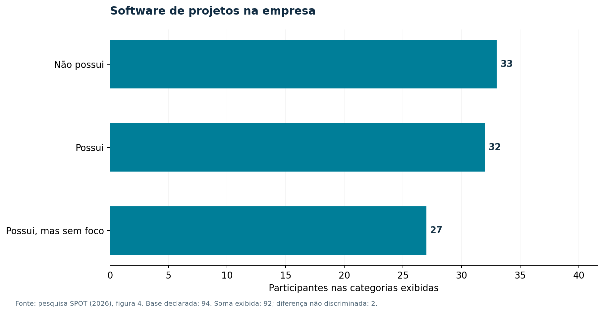

Fonte: Dados de Longo et al. (2026a), reconstituídos pela equipe; base declarada de 94 participantes.

As categorias exibidas somam 92; a diferença de 2 em relação à base de 94 não foi discriminada na fonte. As respostas mostram situações diversas de disponibilidade de software. A distribuição não identifica quais ferramentas atendem a cada organização nem constitui comparação de custo total.

#### 4.2.5 Satisfação com a solução atual

Os dados correspondentes constam da Tabela 5.

Satisfação com a solução atual

| Alternativa | Frequência | % da base 94 |
| --- | --- | --- |
| Sim, mas pode melhorar | 30 | 31,9% |
| Não temos | 29 | 30,9% |
| Sim, atende | 23 | 24,5% |
| Não é usado no dia a dia | 7 | 7,4% |

Fonte: Dados da pesquisa da equipe (Longo et al., 2026a); percentuais calculados nesta edição.

A representação correspondente é apresentada na Figura 5.

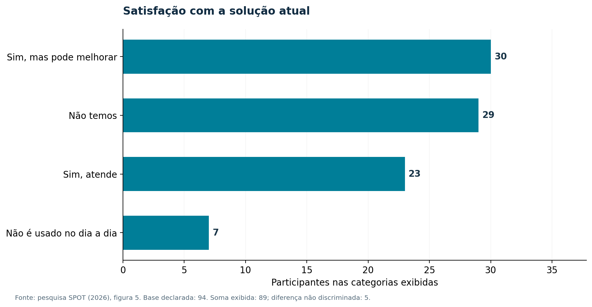

Fonte: Dados de Longo et al. (2026a), reconstituídos pela equipe; base declarada de 94 participantes.

As categorias exibidas somam 89; a diferença de 5 em relação à base de 94 não foi discriminada na fonte. A presença de satisfação parcial e ausência de ferramenta sugere oportunidades de melhoria. Não é avaliação posterior à implantação do SPOT e não deve ser apresentada como índice de satisfação com o produto.

#### 4.2.6 Interface atual é intuitiva?

Os dados correspondentes constam da Tabela 6.

Interface atual é intuitiva?

| Alternativa | Frequência | % da base 94 |
| --- | --- | --- |
| Não temos software | 29 | 30,9% |
| Sim | 28 | 29,8% |
| Mais ou menos | 25 | 26,6% |
| Não | 4 | 4,3% |
| Absolutamente | 4 | 4,3% |

Fonte: Dados da pesquisa da equipe (Longo et al., 2026a); percentuais calculados nesta edição.

A representação correspondente é apresentada na Figura 6.

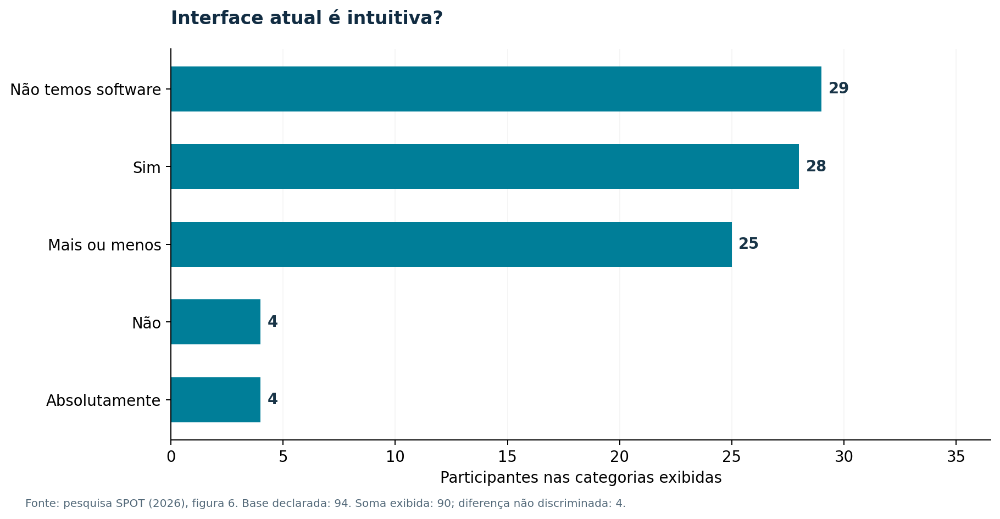

Fonte: Dados de Longo et al. (2026a), reconstituídos pela equipe; base declarada de 94 participantes.

As categorias exibidas somam 90; a diferença de 4 em relação à base de 94 não foi discriminada na fonte. A percepção de interface é um dado descritivo do cenário anterior relatado. A responsividade e o tutorial do SPOT são decisões de implementação, cuja eficácia com usuários precisa de ensaio próprio.

#### 4.2.7 Fluxo de projetos externos

Os dados correspondentes constam da Tabela 7.

Fluxo de projetos externos

| Alternativa | Frequência | % da base 94 |
| --- | --- | --- |
| Sim | 42 | 44,7% |
| Não | 21 | 22,3% |
| Quase nunca | 18 | 19,1% |
| Absolutamente | 9 | 9,6% |

Fonte: Dados da pesquisa da equipe (Longo et al., 2026a); percentuais calculados nesta edição.

A representação correspondente é apresentada na Figura 7.

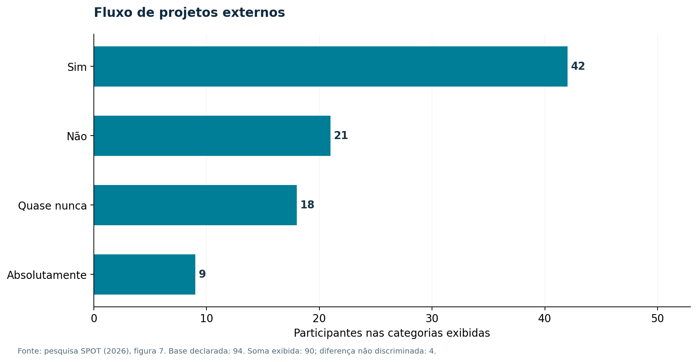

Fonte: Dados de Longo et al. (2026a), reconstituídos pela equipe; base declarada de 94 participantes.

As categorias exibidas somam 90; a diferença de 4 em relação à base de 94 não foi discriminada na fonte. Os fluxos externos motivam observar fronteiras de acesso e responsabilidade. As alternativas foram mantidas literalmente, sem converter o termo absolutamente em uma medida numérica de intensidade.

#### 4.2.8 Fluxo de projetos internos

Os dados correspondentes constam da Tabela 8.

Fluxo de projetos internos

| Alternativa | Frequência | % da base 94 |
| --- | --- | --- |
| Sim | 57 | 60,6% |
| Absolutamente | 16 | 17,0% |
| Não | 9 | 9,6% |
| Quase nunca | 7 | 7,4% |

Fonte: Dados da pesquisa da equipe (Longo et al., 2026a); percentuais calculados nesta edição.

A representação correspondente é apresentada na Figura 8.

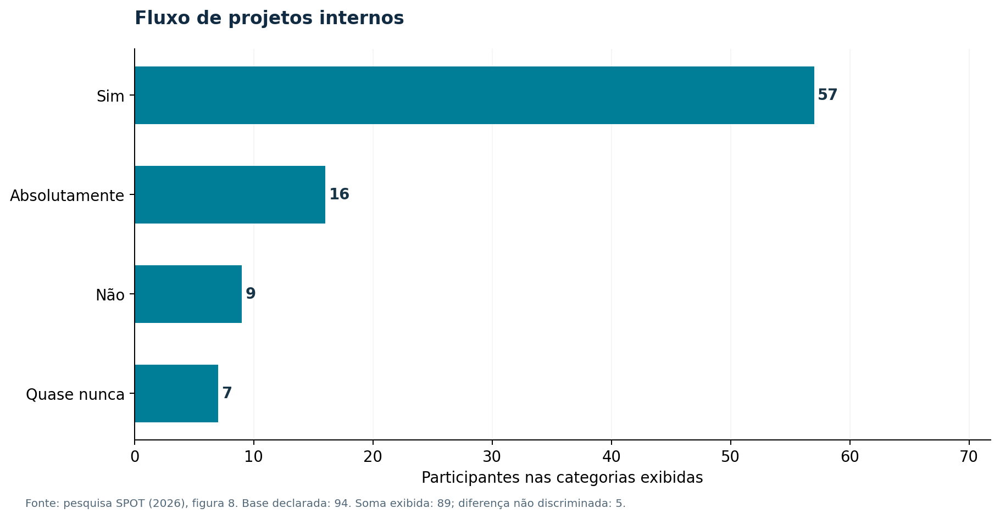

Fonte: Dados de Longo et al. (2026a), reconstituídos pela equipe; base declarada de 94 participantes.

As categorias exibidas somam 89; a diferença de 5 em relação à base de 94 não foi discriminada na fonte. A ocorrência de projetos internos sustenta o tratamento de equipes e vínculos. O resultado não define por si as permissões; estas foram especificadas nas regras de negócio e verificadas no código.

#### 4.2.9 Dificuldade de organização

Os dados correspondentes constam da Tabela 9.

Dificuldade de organização

| Alternativa | Frequência | % da base 94 |
| --- | --- | --- |
| Sim | 49 | 52,1% |
| Não | 16 | 17,0% |
| Talvez | 13 | 13,8% |
| Absolutamente | 11 | 11,7% |

Fonte: Dados da pesquisa da equipe (Longo et al., 2026a); percentuais calculados nesta edição.

A representação correspondente é apresentada na Figura 9.

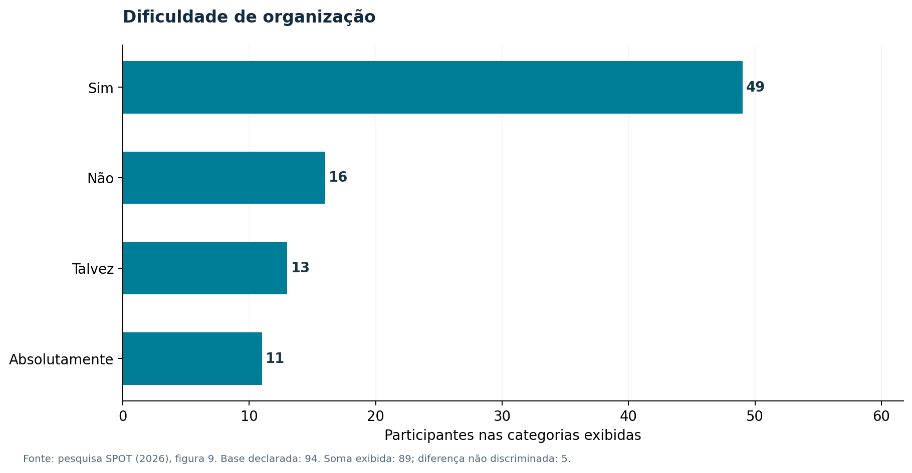

Fonte: Dados de Longo et al. (2026a), reconstituídos pela equipe; base declarada de 94 participantes.

As categorias exibidas somam 89; a diferença de 5 em relação à base de 94 não foi discriminada na fonte. A dificuldade declarada de organização apoia a prioridade de projetos, tarefas e acompanhamento. Não foi medido o tempo antes/depois da adoção da solução.

#### 4.2.10 Dificuldade de alinhamento

Os dados correspondentes constam da Tabela 10.

Dificuldade de alinhamento

| Alternativa | Frequência | % da base 94 |
| --- | --- | --- |
| Não | 31 | 33,0% |
| Sim | 31 | 33,0% |
| Talvez | 20 | 21,3% |
| Absolutamente | 8 | 8,5% |

Fonte: Dados da pesquisa da equipe (Longo et al., 2026a); percentuais calculados nesta edição.

A representação correspondente é apresentada na Figura 10.

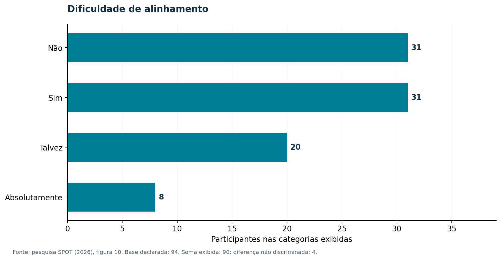

Fonte: Dados de Longo et al. (2026a), reconstituídos pela equipe; base declarada de 94 participantes.

As categorias exibidas somam 90; a diferença de 4 em relação à base de 94 não foi discriminada na fonte. A distribuição de respostas sobre alinhamento não estabelece causalidade. O chat com aprovação específica responde à necessidade de comunicação sem liberar acesso irrestrito entre empresas.

#### 4.2.11 Organização ajuda no faturamento?

Os dados correspondentes constam da Tabela 11.

Organização ajuda no faturamento?

| Alternativa | Frequência | % da base 94 |
| --- | --- | --- |
| Sim | 57 | 60,6% |
| Absolutamente | 26 | 27,7% |
| Talvez | 4 | 4,3% |
| Não | 4 | 4,3% |

Fonte: Dados da pesquisa da equipe (Longo et al., 2026a); percentuais calculados nesta edição.

A representação correspondente é apresentada na Figura 11.

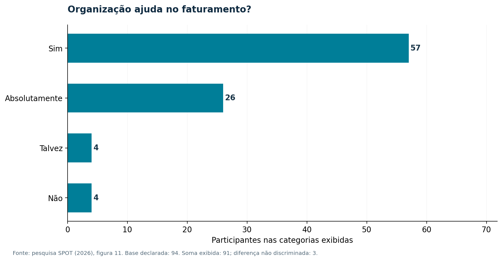

Fonte: Dados de Longo et al. (2026a), reconstituídos pela equipe; base declarada de 94 participantes.

As categorias exibidas somam 91; a diferença de 3 em relação à base de 94 não foi discriminada na fonte. A percepção de relação entre organização e faturamento não é uma mensuração financeira. Os indicadores implementados oferecem apoio gerencial, sem provar aumento de receita decorrente do software.

#### 4.2.12 Dificuldade de registrar custos extras

Os dados correspondentes constam da Tabela 12.

Dificuldade de registrar custos extras

| Alternativa | Frequência | % da base 94 |
| --- | --- | --- |
| Não | 33 | 35,1% |
| Talvez | 26 | 27,7% |
| Sim | 21 | 22,3% |
| Absolutamente | 9 | 9,6% |

Fonte: Dados da pesquisa da equipe (Longo et al., 2026a); percentuais calculados nesta edição.

A representação correspondente é apresentada na Figura 12.

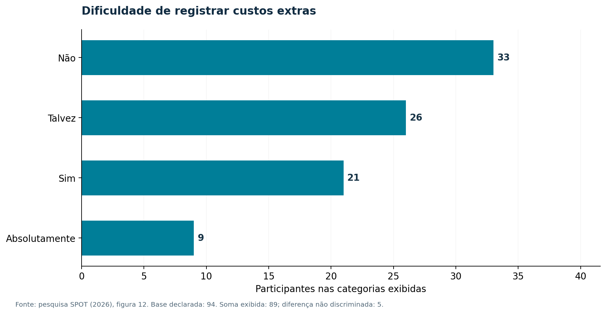

Fonte: Dados de Longo et al. (2026a), reconstituídos pela equipe; base declarada de 94 participantes.

As categorias exibidas somam 89; a diferença de 5 em relação à base de 94 não foi discriminada na fonte. A questão de custos adicionais motivou a rastreabilidade de despesas e planejamento. As frequências não permitem calcular perdas monetárias nem retorno do investimento.

#### 4.2.13 Necessidade de software dedicado

Os dados correspondentes constam da Tabela 13.

Necessidade de software dedicado

| Alternativa | Frequência | % da base 94 |
| --- | --- | --- |
| Talvez | 33 | 35,1% |
| Sim | 32 | 34,0% |
| Não | 14 | 14,9% |
| Absolutamente | 11 | 11,7% |

Fonte: Dados da pesquisa da equipe (Longo et al., 2026a); percentuais calculados nesta edição.

A representação correspondente é apresentada na Figura 13.

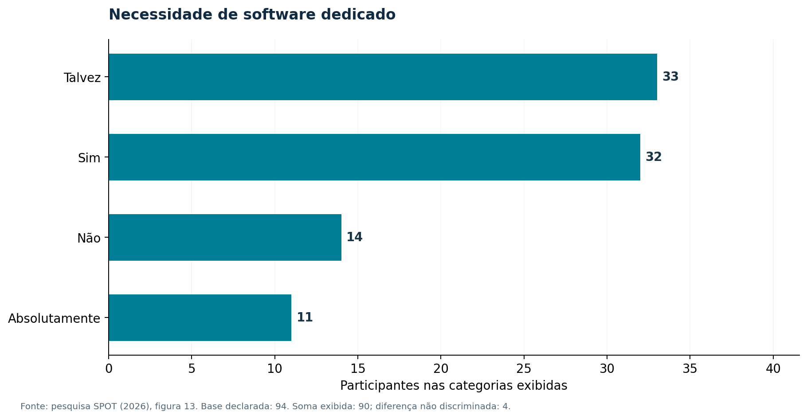

Fonte: Dados de Longo et al. (2026a), reconstituídos pela equipe; base declarada de 94 participantes.

As categorias exibidas somam 90; a diferença de 4 em relação à base de 94 não foi discriminada na fonte. As respostas sobre necessidade de solução dedicada orientam a investigação, sem constituir estimativa de adesão ao SPOT. Não há cruzamento individual disponível para afirmar preferência em subgrupos específicos.

### 4.3 Resultados qualitativos e inconsistências

Os dados correspondentes constam da Tabela 14.

Sugestões abertas recuperadas

| Tema | Frequência publicada |
| --- | --- |
| Interface simples | 12 |
| Controle financeiro | 6 |
| Integrações e e-mail | 6 |
| Dashboards | 5 |
| Tarefas, agenda e prazos | 5 |
| Automação e IA | 3 |
| Sem sugestão específica | 12 |

Fonte: Documento da pesquisa (Longo et al., 2026a); frequências temáticas, não falas literais.

O texto original declara 57 comentários, enquanto a tabela temática soma 49 frequências. Sem os registros individuais e o procedimento de codificação, não é possível reconciliar as oito unidades de diferença nem verificar sobreposição. Não foram criadas categorias ou depoimentos para completar o total.

### 4.4 Relação entre achados e requisitos

As informações correspondentes estão organizadas no Quadro 2.

Da pesquisa às decisões de implementação

| Achado documental | Resposta técnica | Evidência e limite |
| --- | --- | --- |
| Interface e organização | Navegação, tarefas e tutorial em três idiomas | Testes de interface; eficácia com público real pendente. |
| Integração e comunicação | Correio, agenda, notificações e chat com aprovador | Fluxos testados com serviços simulados; homologação externa pendente. |
| Controle financeiro | Horas, tarifas, despesas e portfólio | Cálculos e acesso cobertos por testes; não demonstra ganho financeiro. |
| Automação e IA | Regras de notificação e tradução opcional | Não se afirma implementação de agente gerencial ou IA generativa. |

Fonte: Elaboração própria a partir da pesquisa (Longo et al., 2026a) e do código (Longo et al., 2026c).

## 5 ARQUITETURA E AMBIENTE TECNOLÓGICO

O SPOT organiza interface, interface de programação de aplicações (API), regras de domínio e persistência no mesmo repositório, com responsabilidades separadas. O navegador apresenta o estado e envia requisições; o servidor valida e autoriza cada operação; classes de domínio e modelos implementam invariantes e transações. A integração não depende de um servidor de inferência para executar as funções centrais (Longo et al., 2026c).

### 5.1 Componentes e versões

A documentação oficial do Laravel descreve o ciclo de requisição e os serviços de uma aplicação PHP: Hypertext Preprocessor (PHP); o React estrutura a interface em componentes, enquanto o Vite fornece o servidor de desenvolvimento e a construção dos recursos estáticos (Laravel, 2026; Meta Platforms, [20--]; Vite, [20--]). As versões do produto são obtidas dos manifestos, lockfiles e verificações do projeto, não da versão mais recente anunciada nos sites.

As informações correspondentes estão organizadas no Quadro 3.

Tecnologias da versão consultada

| Camada | Tecnologia | Aplicação |
| --- | --- | --- |
| Servidor | PHP 8.3; Laravel 13 | Rotas, validação, autorização, transações, filas e correio. |
| Interface | React 18.3.1; Vite 8.3.5 | Componentes, estado, navegação da aplicação e compilação dos assets. |
| Persistência | PostgreSQL; imagem PostgreSQL 17 | Banco relacional único; SQLite não é o banco da versão final. |
| Analytics | Python 3; pandas 2.3.3 na imagem verificada | Consolidação de indicadores; requirements.txt admite pandas >=2.2 e <3.0. |
| Editor do chat | Tiptap / ProseMirror | Documento estruturado, listas, links e atalhos, com validação no servidor. |
| Autenticação | Sessão/Sanctum e JWT | Sessão da aplicação principal; JWT nas rotas de compatibilidade e estoque. |
| Operação | Docker Compose; FrankenPHP/Caddy | Serviços web, worker, scheduler e PostgreSQL; certificados dependem do domínio real. |

Fonte: Elaboração própria com base no código-fonte do SPOT (Longo et al., 2026c).

A representação correspondente é apresentada na Figura 14.

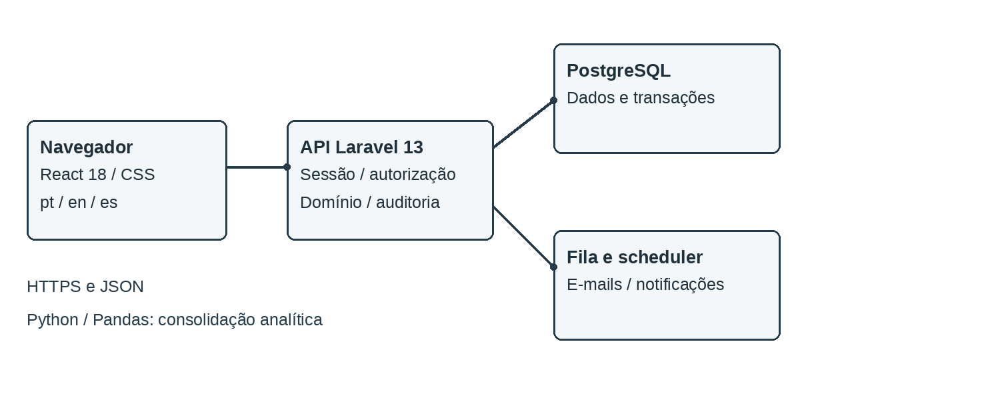

Fonte: Elaboração própria a partir do código-fonte (Longo et al., 2026c).

### 5.2 Banco relacional e concorrência

O PostgreSQL é a persistência única da versão final. Referências a SQLite na monografia preliminar descrevem um estado anterior e foram retiradas da descrição do sistema atual. As migrations definem evolução de tabelas e relacionamentos; transações e bloqueios de linha protegem decisões, movimentações e alterações de equipe. A documentação PostgreSQL fundamenta o uso de integridade e controle transacional (PostgreSQL Global Development Group, 2026).

Na alteração de equipe, um bloqueio no registro do projeto serializa operações que poderiam remover simultaneamente os últimos responsáveis. No chat, o par de usuários é representado por uma conversa e os pedidos pendentes são conferidos sob transação. Esses controles sustentam o comportamento verificado nos testes; não constituem, por si, um ensaio de escalabilidade (Longo et al., 2026c).

### 5.3 Comunicação e implantação

A aplicação principal utiliza JavaScript Object Notation (JSON) e rotas versionadas sob /api/v1, com sessão, cookies e proteção Cross-Site Request Forgery (CSRF) nas operações mutáveis. A compatibilidade por token e o estoque utilizam JSON Web Token (JWT) em suas rotas. OAuth conecta provedores externos; sua homologação requer credenciais e permissões reais. Falhas de validação são apresentadas próximas aos formulários e não devem expor Structured Query Language (SQL), traces ou segredos.

O Docker Compose descreve serviços e volumes da aplicação (Docker, 2026). O empacotamento do SPOT inclui web, worker e scheduler, além do PostgreSQL. E-mails usam a fila emails; atividades e limpezas periódicas são agendadas dentro do processo PHP. O arquivo .env e dados de usuários não integram a imagem (Longo et al., 2026c).

## 6 REQUISITOS, REGRAS E FUNCIONALIDADES

As funcionalidades são descritas por operações, critérios de acesso e condições de funcionamento. As regras estabelecem as responsabilidades dos perfis e os controles aplicados pelo servidor.

### 6.1 Requisitos rastreáveis

Os requisitos foram derivados das necessidades registradas pela equipe e refinados por comportamento observável no código. Requisito funcional descreve uma operação ou restrição; requisito não funcional trata de qualidades e condições de uso. A entrega inclui autenticação, governança, projetos, tarefas, horas, finanças, comunicação e operação, com rastreabilidade entre regra, componente e teste (Longo et al., 2026c).

As informações correspondentes estão organizadas no Quadro 4.

Regras centrais verificadas

| Identificação | Tema | Regra |
| --- | --- | --- |
| RN01 | Provisionamento | Somente usuário com alçada administrativa provisiona conta e gera link de ativação; não há solicitação pública de primeiro acesso. |
| RN02 | Ativação | O e-mail deve corresponder à conta do token; o nome não precisa coincidir. Token deve estar válido e não utilizado; senha precisa de confirmação. |
| RN03 | Reenvio | Uma transição de outro estado para aguardando ativação gera novo link e agenda e-mail; editar uma conta já pendente não repete o envio. |
| RN04 | Projeto | Gerente do projeto obrigatório na criação v1; o responsável entra como manager na equipe. Não se permite remover ou rebaixar o último gerente elegível da equipe. |
| RN05 | Visibilidade | Empresa atual, perfis, participação e exceções de permissão limitam os dados e as operações. Interface não substitui autorização do servidor. |
| RN06 | Chat direto | Exige vínculo ativo de analyst ou manager dos dois usuários em um mesmo projeto, ou autorização específica válida para o par. |
| RN07 | Pedido de chat | Pessoa, motivo e aprovador são obrigatórios. O aprovador é administrador ou gerente administrador ativo da mesma empresa, diferente do solicitante, inclusive fora do projeto. |
| RN08 | Decisão | Novo pedido vai apenas ao aprovador escolhido; só ele aprova/recusa. Uma pendência por par impede duplicação, inclusive inversa. Pedidos antigos sem destinatário mantêm a compatibilidade. |
| RN09 | Restrições do chat | Convidados e contas inativas não usam o chat. Aprovar não concede leitura de conversas de terceiros. Revogação preserva histórico. |
| RN10 | Mensagens | Apenas autor edita até 24 horas do envio original; versões concorrentes são verificadas. Original e revisões são preservados. |
| RN11 | Tradução | Bandeiras pt/en/es escolhem apenas destino de tradução da mensagem; original preservado. Serviço externo configurado é necessário. |
| RN12 | Recuperação | Intervalo de 60 segundos entre gerações para o mesmo e-mail; link vale 60 minutos. Nova geração substitui a anterior, sem divulgar existência da conta. |
| RN13 | Projetos finalizados | Restrições a alterações e preservação do histórico seguem os endpoints e permissões aplicáveis. |
| RN14 | Despesas e tarifas | Despesas passam pelo fluxo de revisão; custos e preços usam tarifas e vigências, sem sobreposições indevidas. |
| RN15 | Notificações | Preferências, canal, frequência e silêncio condicionam entrega; processamento em fila e deduplicação evitam reenvios indevidos. |

Fonte: Elaboração própria com base no código-fonte do SPOT (Longo et al., 2026c).

### 6.2 Identidade, convite e primeiro acesso

O primeiro acesso é iniciado por provisionamento administrativo. O link utiliza token com hash persistido, validade e controle de uso. A identificação da ativação compara somente o e-mail com a conta associada ao convite, desconsiderando caixa e espaços nas extremidades; não exige que o nome digitado coincida com o cadastro. O nome administrativo é preservado. Quando o e-mail diverge, a interface orienta: Por gentileza, insira o e-mail correspondente ao do convite enviado! A validade do token e a confirmação da senha continuam obrigatórias.

Uma nova entrada da conta em aguardando ativação revoga links anteriores ainda não usados, cria outro token e agenda a mensagem após confirmar a transação. A validade da ativação administrativa é de 48 horas. Edição de cargo ou perfil de uma conta já pendente não é um novo evento de reenvio. A recuperação de senha é um fluxo diferente: o link vale 60 minutos e há intervalo de 60 segundos entre gerações para a mesma conta (Longo et al., 2026c).

### 6.3 Projetos, equipe e execução

O cadastro v1 exige gerente do projeto elegível. O usuário selecionado entra na equipe como manager, sem duplicação se também constar na seleção inicial. Equipes, atribuições e remoções de membros preservam ao menos um gerente ativo elegível, sincronizando o campo de referência quando necessário. Perfis de administrador, gerente administrador e gerente podem ser elegíveis para a função, conforme as regras do servidor.

Projetos concentram contrato, situação, datas, membros e planejamento. Tarefas oferecem visualizações de trabalho e apontamentos; tarifas possuem vigência, e despesas passam por revisão. Finalização e reabertura seguem autorização e preservação do histórico. O módulo de documentos mantém suas regras de privacidade: associar um arquivo a projeto ou tarefa não equivale a compartilhá-lo com toda a equipe (Longo et al., 2026c).

### 6.4 Chat e aprovação direcionada

O chat é individual e restrito à empresa atual. Há acesso direto quando os dois usuários possuem participação ativa, não revogada, com papel analyst ou manager em um mesmo projeto. Fora desse vínculo, o formulário solicita pessoa, motivo e o destinatário em Enviar aprovação para. A lista contém administradores e gerentes administradores ativos e elegíveis da mesma empresa, excluindo o solicitante; podem estar fora do projeto.

O campo assigned_reviewer_id registra quem recebeu o novo pedido; reviewer_id registra quem decidiu. Somente o escolhido recebe o aviso e pode aprovar ou recusar. A autorização vale para o par, e não libera a leitura de conversas de terceiros. Pedidos antigos sem atribuição mantêm compatibilidade com o fluxo anterior. Uma pendência por par impede duplicação, inclusive em sentido inverso; pedidos recusados ou revogados permitem nova tentativa conforme a elegibilidade (Longo et al., 2026c).

Apenas o autor pode editar uma mensagem, até 24 horas do envio original. As revisões são preservadas e uma versão é conferida para evitar sobrescrita concorrente. Anexos usam acesso autorizado e descrições de imagem podem ser informadas. O editor fornece formatação e atalhos; Enter envia e Ctrl + Shift + Enter insere nova linha. A existência de autorização de revisão não concede acesso ao conteúdo de uma conversa alheia.

A representação correspondente é apresentada na Figura 15.

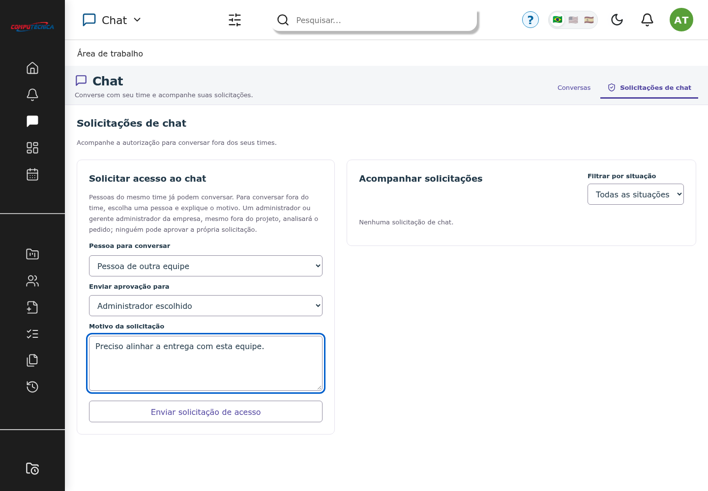

Fonte: Interface do build local, com massa sintética e API simulada; captura de teste, 10 nov. 2026.

### 6.5 Agenda, notificações e e-mails

A agenda reúne eventos internos e conexões externas disponíveis. Grupos, participantes, fuso e detalhes são validados. As notificações consideram preferências por canal, silêncio, frequência e deduplicação. Resumos diários ou semanais e envios imediatos são processados em lotes e filas, com tratamento de falha e nova tentativa (Longo et al., 2026c).

Ativação, convite, recuperação e notificações compartilham o layout de correio: cabeçalho Spot, título, ação, link alternativo e rodapé, com alternativa em texto simples. Textos de estrutura possuem pt/en/es; dados escritos por pessoas são preservados e escapados no HTML. Disponibilidade de Simple Mail Transfer Protocol (SMTP), reputação do remetente e apresentação em clientes de e-mail reais exigem homologação separada.

### 6.6 Portfólio e processamento analítico

Os relatórios consolidam situação, custos, receitas, margens, horas e despesas, usando processos Python com pandas. A biblioteca fornece estruturas e operações de análise de dados (Pandas Development Team, 2026). No SPOT, os cálculos dependem dos registros e permissões existentes; falta de tarifa ou base de cálculo não é convertida automaticamente em evidência de lucro ou desempenho.

Painéis permitem indicadores e diferentes visualizações, agregações e exportação CSV. Resultados parciais são identificados. Uma falha do detalhamento financeiro é tratada localmente sem cobrir todos os outros indicadores com uma tela global de erro. O resultado financeiro é gerencial, depende da qualidade dos dados e não equivale a demonstração contábil auditada (Longo et al., 2026c).

### 6.7 Idiomas, acessibilidade e tutorial

A interface dispõe de português, inglês e espanhol, ajustes de fonte, escala e tema, indicação de foco e respeito à redução de movimento e cores forçadas. O objetivo de acessibilidade é WCAG 2.2 nível AA, referência que abrange diferentes necessidades de uso; resultados automatizados não substituem avaliação humana nem certificam conformidade integral (World Wide Web Consortium, 2024).

O tutorial é opcional e seleciona as etapas conforme permissões e disponibilidade do chat. Explica navegação, projetos, execução, segurança e solicitações, sem enviar formulários de negócio. A mudança de idioma dentro do passeio não grava alterações na conta. A posição dos destaques é verificada para telas disponíveis e áreas restritas. Nomes e conteúdos pessoais usam marcação para impedir tradução automática da interface (Longo et al., 2026c).

### 6.8 Tradução automática e escopo de IA

As bandeiras no cabeçalho da conversa escolhem apenas o destino da tradução da mensagem, sem alterar o idioma global. O texto traduzido é apresentado no balão, identificado como automático, com acesso ao original. A integração opcional usa o endpoint de tradução do LibreTranslate (LibreTranslate, [20--]). Credenciais e endereço do serviço permanecem no servidor.

É necessário distinguir tradução automática de agentes de planejamento ou geração de conteúdo. A versão final não demonstra um agente generativo para estimar projetos, redistribuir equipes ou tomar decisões gerenciais. Automação de notificações, regras determinísticas e consolidação com pandas também não são, por si, implementação de inteligência artificial. A pesquisa de tecnologias de IA é referência de possibilidades, não prova de entrega dessas funções.

## 7 MODELO DE DADOS E CONTRATOS DE API

O esquema é descrito por migrations versionadas. As entidades agrupam identidade, organização, trabalho, finanças, comunicação e operação. O quadro a seguir é um mapa de domínio; o apêndice de migrations e os arquivos do repositório são a referência para nomes, tipos, nulabilidade, índices e chaves exatos (Longo et al., 2026c).

As informações correspondentes estão organizadas no Quadro 5.

Grupos de dados

| Domínio | Entidades principais | Responsabilidade |
| --- | --- | --- |
| Identidade e acesso | users, profiles, permissions, company_user_profiles, user_permission_overrides | Contas, empresa atual, perfis e exceções. |
| Organização e projetos | companies, organizations, clients, projects, project_members | Responsáveis, contrato, equipe e vínculos. |
| Execução e finanças | tasks, work_logs, project_expenses, analyst_project_rates, project_taxes | Atividades, horas, despesas, tarifas e composição financeira. |
| Convites e ativação | project_invitations, user_activation_tokens | Tokens armazenados como hash, validade e uso/revogação. |
| Chat | chat_conversations, chat_access_requests, chat_messages, chat_message_revisions, chat_attachments | Par de usuários, aprovador escolhido/decisor, versões e anexos privados. |
| Agenda e notificações | calendar_events, calendar_deliveries, calendar_event_changes, inbox_items, notification_deliveries, notification_mail_batches | Eventos, participantes/grupos, alertas, entregas e resumos. |
| Operação | jobs, failed_jobs, audit_logs e tabelas de sessão/cache | Fila, falhas, rastreabilidade e suporte ao runtime. |
| Estoque | categories, products, stock_movements | Camada de compatibilidade com autenticação JWT e movimentação atômica. |

Fonte: Elaboração própria com base no código-fonte do SPOT (Longo et al., 2026c).

### 7.1 Vínculos e integridade

Uma empresa limita as contas e os projetos visíveis. Projetos relacionam responsáveis e membros; tarefas, horas e despesas referenciam o contexto de execução. Conversas representam um par ordenado de usuários, enquanto solicitações, mensagens, revisões e anexos mantêm relações separadas. Tokens de acesso não são armazenados em texto simples. O responsável escolhido para aprovação não é confundido com o usuário que concluiu a decisão.

A preservação do histórico é parte do domínio: revogar autorização não remove mensagens; finalização limita operações sem apagar a trajetória do projeto; exclusão de registros com dependências segue restrições e regras aplicáveis. A normalização lógica evita repetir a mesma credencial, perfil ou estado em entidades sem necessidade, embora haja snapshots controlados para rastreabilidade de valores e decisões.

### 7.2 Contratos e erros

O inventário exportado pelo Laravel contém 170 rotas no ambiente consultado, incluindo infraestrutura e framework. Esse total não representa 170 funcionalidades de negócio. O apêndice discrimina rotas da aplicação e o manifesto preserva o critério de extração.

Respostas de validação usam a estrutura errors e os códigos Hypertext Transfer Protocol (HTTP) compatíveis com o problema. Requisições sem autorização, recursos não visíveis, conflito de estado e indisponibilidade têm tratamentos distintos. O cliente de sessão inicializa CSRF antes das mutações e só publica eventos de atualização após sucesso; logout não dispara recarga automática de dados privados. Validações críticas continuam no servidor (Longo et al., 2026c).

As informações correspondentes estão organizadas no Quadro 6.

Rastreabilidade entre implementação e testes

| Área | Artefatos | Verificação |
| --- | --- | --- |
| Identidade | app/Http/Controllers/Api/AdminUserController.php; FirstAccessController.php | AdministrativeProvisioningTest; ActivationStatusEmailTest |
| Projetos/equipe | ProjectController.php; TeamController.php; ProjectTeamManagers.php | RequiredProjectManagerTest; InitialProjectTeamTest |
| Chat e aprovação | app/Domain/Chat/ChatAccess.php; ChatController.php; ChatPage.jsx | ChatTest; scripts/test-chat.mjs |
| Editor e original | ChatRichEditor.jsx; ChatFormattedText.jsx; chatFormatting.js | scripts/test-chat-formatting.mjs |
| Correio e idioma | app/Mail; app/Domain/Mail; resources/views/mail | LocalizedResetMailTest; StandardizedMailTest |
| Notificações/agenda | NotificationCenter; SendNotificationBatch; CalendarController | NotificationDeliveryTest; testes de agenda |
| Acessibilidade/tutorial | useModalFocus.js; usePopoverPosition.js; tutorial/content.js | test-accessibility.mjs; test-public-accessibility.mjs; test-tutorial.mjs |
| Analytics | ProjectAnalyticsController.php; scripts/project_analytics.py; PortfolioChart.jsx | FinancialReportTest; test-portfolio.mjs |
| Implantação | Dockerfile; docker-compose.yml; routes/console.php | ProductionSchedulerTest; verify-container-tests.py; check-production.php |

Fonte: Elaboração própria com base no código-fonte do SPOT (Longo et al., 2026c).

## 8 VERIFICAÇÃO, RESULTADOS E LIMITES

A evidência técnica corresponde à execução registrada em 10 de novembro de 2026. O código consultado foi identificado por commit e acompanhado de logs e inventários. Resultados antigos de 52 testes e 262 asserções pertencem a uma edição anterior e não descrevem a versão final. A quantidade de testes não deve ser interpretada como quantidade de funcionalidades nem como cobertura total (Longo et al., 2026c).

As informações correspondentes estão organizadas no Quadro 7.

Síntese da verificação da versão final

| Verificação | Resultado | Limite |
| --- | --- | --- |
| PHPUnit local | 256 testes; 3.487 asserções; aprovado | Schema spot_testing; dados sintéticos. |
| PHPUnit em contêiner | 256 testes; 3.487 asserções; aprovado | PHP 8.3 e PostgreSQL descartável; serviços externos simulados. |
| Navegador | 36 suítes aprovadas | Chromium; não representa todos os navegadores. |
| Responsividade | 323 verificações aprovadas | 320–1440 px; orientação vertical/horizontal; leitura 100%/120%. |
| Tutorial | 756 verificações; sem erros | Regras de navegação, permissões, idioma e ausência de mutações de negócio. |
| Idiomas | 144 verificações; sem falhas ou apontamentos | Cobertura dos percursos automatizados; não certifica toda expressão possível. |
| Chat/editor | 170 verificações; formatação 3 × 100 | Inclui atalhos, destinatário e preservação do original. |
| Correio | 36 prévias de layout | Seis variantes; três idiomas; duas larguras; sem destinatários reais. |
| Build e dependências | Build e auditorias sem avisos na rodada final | Situação verificada na data de corte, não garantia permanente. |
| Docker | Imagem construída e rotas públicas com HTTP 200 | Não é ensaio de certificado, rede de produção ou SMTP real. |

Fonte: Elaboração própria com base no código-fonte do SPOT (Longo et al., 2026c).

### 8.1 Cobertura comportamental

Os testes incluem autorização, isolamento de empresa, identidade, ativação e reenvio, recuperação, mudanças de projeto, gerente obrigatório, acesso a documentos, despesas, tarifas e notificações. No chat, verificam participação, aprovação selecionada, autoaprovação proibida, duplicatas, edição, versões, anexos e revogação. Nos testes de correio, a entrega usa transporte em memória; não há envio para destinatários reais.

Na interface, foram usados nomes longos, tela estreita, orientação horizontal, tema, escala de leitura, fluxo por teclado, foco em modais, retorno de foco e tradução. O teste do editor foi repetido após corrigir a disputa de foco. O passeio do tutorial foi percorrido segundo permissões, inclusive quando relatórios não estão disponíveis (Longo et al., 2026c).

### 8.2 Ameaças à validade e critérios de aceite

A avaliação automatizada comprova apenas os cenários exercitados no ambiente descrito. Não houve comprovação empírica de redução de custo, aumento de produtividade ou satisfação após implantação. Não foram realizados testes de carga com volume real, auditoria ofensiva completa, homologação com todos os clientes de e-mail ou avaliação humana integral com leitor de tela.

Para aceite operacional, devem ser confirmados domínio e Hypertext Transfer Protocol Secure (HTTPS), segredos, banco e migrations, armazenamento, backup e restauração, workers e scheduler. Recursos Google, Microsoft, SMTP e tradução dependem das permissões e serviços reais. A existência de uma integração no código não equivale à autorização de um tenant nem à disponibilidade do provedor. Não se declara conformidade integral WCAG ou liberação incondicional para produção.

## 9 IMPLANTAÇÃO E CONTINUIDADE

A entrada em operação depende do ambiente de destino e da homologação das integrações. Esta seção organiza os requisitos de configuração, validação e manutenção.

### 9.1 Preparação e configuração

A implantação proposta usa Docker Compose com serviços web, worker, scheduler e PostgreSQL. O domínio precisa apontar para o servidor e o proxy depende de condições reais para emitir HTTPS. O arquivo .env.production é preenchido a partir do modelo; APP_KEY e JWT_SECRET devem ser configuradas e preservadas nas atualizações. A chave JWT é necessária para o estoque e a autenticação por token. Segredos não integram o Git nem os documentos de consulta.

O build inclui os arquivos estáticos, dependências PHP de produção e ambiente Python para os relatórios. Backups, uploads locais, evidências de testes, .env e public/hot são excluídos do artefato. Uploads reais permanecem nos volumes de armazenamento. Migrations são aplicadas após backup e revisão; o seed da conta inicial não deve ser executado como rotina de atualização (Longo et al., 2026c).

### 9.2 Validação do servidor de destino

O verificador scripts/check-production.php é somente leitura: verifica ambiente, debug, origem HTTPS, cookies, chaves, correio configurado, existência de assets, diretórios graváveis e conexão/migrations. Sua saída não expõe credenciais nem envia mensagens. Mesmo com saída zero, é necessária a homologação externa e a conferência dos responsáveis nos dados transferidos.

A revisão local identificou três projetos antigos sem o campo de gerente do projeto preenchido, embora todos possuíssem gerente ativo na equipe. Não houve escolha automática de responsáveis. Esse achado refere-se ao conjunto local revisado e deve ser reavaliado na base que será implantada; não é uma característica fixa do software.

### 9.3 Operação e manutenção

Workers devem consumir emails e default, e o scheduler deve ser executado por minuto. Há controles de nova tentativa e consulta de falhas. Backups devem incluir banco e arquivos, com restauração efetivamente testada. Uma mudança de chave pode afetar dados e jobs criptografados; atualizar a aplicação não exige substituir as chaves existentes.

A manutenção deve preservar rastreabilidade entre alteração, teste, documentação e release. A equipe ainda precisa concluir a validação humana de acessibilidade, os testes com provedores reais e a observação sob carga de uso. O custo de infraestrutura, correio, manutenção e suporte continua existindo; ausência de uma assinatura de software de terceiros não significa operação sem custos.

### 9.4 Consulta ao código e reprodução

O repositório abaixo permite consultar a estrutura, as regras, as migrations e os testes. A referência de versão evita atribuir à monografia funcionalidades introduzidas posteriormente. A data de acesso foi registrada e a disponibilidade de consulta depende das permissões configuradas no GitHub.

[Repositório do SPOT: https://github.com/iamnotlittleprince/SPOT](https://github.com/iamnotlittleprince/SPOT)

[Versão do código analisada: 146bd986867ecb25bc75db53c6d1944c6d89ae66](https://github.com/iamnotlittleprince/SPOT/tree/146bd986867ecb25bc75db53c6d1944c6d89ae66)

O commit consultado corresponde ao HEAD remoto confirmado durante a revisão. A documentação gerada nesta atualização pode ainda estar como alteração local; ela não é considerada publicada apenas por existir na pasta do projeto. O manifesto de fontes e a pasta de evidências registram a procedência da edição.

## 10 CONSIDERAÇÕES FINAIS

A versão final do SPOT materializa uma aplicação integrada para identidade, projetos, equipes, execução, finanças e comunicação. A governança é parte funcional da solução: projeto exige responsável, acesso é verificado no servidor e a conversa externa depende de autorização direcionada. O resultado acadêmico é uma base implementada, documentada e verificável, relacionada às necessidades e sugestões da pesquisa.

A verificação registrou aprovação dos testes de servidor e navegador, construção do frontend e da imagem, e auditorias de dependências sem avisos na rodada final. Esses resultados demonstram os cenários cobertos, com dados sintéticos e serviços simulados; não provam ausência de defeitos, ganho financeiro ou conformidade integral das diretrizes de acessibilidade. A revisão também identifica ações de configuração, responsáveis antigos e serviços reais antes de liberar produção.

A continuidade deve incluir homologação com usuários e tecnologias assistivas, validação das integrações no domínio definitivo e observação sob carga. O repositório e o identificador de versão permitem consultar a implementação e acompanhar evolução posterior sem confundi-la com o recorte desta monografia. Dessa forma, o trabalho articula pesquisa, construção e evidência, preservando os limites de cada uma dessas dimensões.

## 11 PREPARAÇÃO PARA A DEFESA

A demonstração deve utilizar dados sintéticos e acompanhar a versão analisada. O roteiro e as questões de ensaio distinguem resultados verificados de pendências de homologação.

### 11.1 Demonstração sugerida

Preparar uma base sintética e demonstrar: acesso administrativo, cadastro de projeto com gerente, tarefa e apontamento, leitura de indicadores, pedido de chat com pessoa, motivo e aprovador escolhido, decisão do destinatário e conversa autorizada. Mostrar o tutorial e os três idiomas. Usar prévias de e-mail quando não houver SMTP homologado. Não expor nomes, mensagens, credenciais ou contratos reais.

### 11.2 Perguntas e limites

As informações correspondentes estão organizadas no Quadro 8.

Questões para ensaio

| Pergunta | Resposta sustentada pela versão final |
| --- | --- |
| Os testes comprovam ausência de defeitos? | Não. Os 256 testes e 3.487 asserções cobrem cenários definidos; as 36 suítes de navegador complementam a verificação. |
| Quem aprova o chat? | O administrador ou gerente administrador ativo da mesma empresa escolhido pelo solicitante, sem autoaprovação; vínculos diretos de equipe dispensam pedido. |
| Qual banco é usado? | PostgreSQL. SQLite não descreve o ambiente da versão final. |
| Há inteligência artificial? | Há integração opcional de tradução automática. Não foi entregue agente generativo de planejamento ou decisão gerencial. |
| A pesquisa demonstra ganho de receita? | Não. A amostra de conveniência descreve percepções; não houve estudo de impacto antes/depois. |
| Já pode afirmar produção homologada? | A configuração real, os responsáveis legados, SMTP/OAuth e avaliação humana ainda precisam de aceite. |
| Onde consultar a implementação? | https://github.com/iamnotlittleprince/SPOT; commit 146bd986867ecb25bc75db53c6d1944c6d89ae66. |

Fonte: Elaboração própria com base no código-fonte do SPOT (Longo et al., 2026c).

### 11.3 Material histórico

Os slides e roteiros produzidos anteriormente foram preservados. Eles não foram sincronizados automaticamente nesta revisão: números, capturas, tempos e falas precisam de conferência antes da apresentação. Este guia e a monografia final identificam a referência técnica vigente, sem inventar duração de ensaio ou aprovação da banca.

## REFERÊNCIAS

AMAZON WEB SERVICES. **Cloud computing services**. AWS, c2026. Disponível em: https://aws.amazon.com/. Acesso em: 10 nov. 2026.

ASANA. **Asana work management**. Asana, c2026. Disponível em: https://asana.com/product. Acesso em: 10 nov. 2026.

ASSOCIAÇÃO BRASILEIRA DE NORMAS TÉCNICAS. **ABNT NBR 10520:2023**. Informação e documentação — Citações em documentos — Apresentação. Rio de Janeiro: ABNT, 2023.

ASSOCIAÇÃO BRASILEIRA DE NORMAS TÉCNICAS. **ABNT NBR 14724:2024**. Informação e documentação — Trabalhos acadêmicos — Apresentação. Rio de Janeiro: ABNT, 2024. Versão corrigida em 1 abr. 2025.

ASSOCIAÇÃO BRASILEIRA DE NORMAS TÉCNICAS. **ABNT NBR 6023:2025**. Informação e documentação — Referências — Elaboração. Rio de Janeiro: ABNT, 2025.

ASSOCIAÇÃO BRASILEIRA DE NORMAS TÉCNICAS. **ABNT NBR 6024:2012**. Informação e documentação — Numeração progressiva das seções de um documento — Apresentação. Rio de Janeiro: ABNT, 2012a.

ASSOCIAÇÃO BRASILEIRA DE NORMAS TÉCNICAS. **ABNT NBR 6027:2012**. Informação e documentação — Sumário — Apresentação. Rio de Janeiro: ABNT, 2012b.

ASSOCIAÇÃO BRASILEIRA DE NORMAS TÉCNICAS. **ABNT NBR 6028:2021**. Informação e documentação — Resumo, resenha e recensão — Apresentação. Rio de Janeiro: ABNT, 2021.

ATLASSIAN. **Jira**. Atlassian, c2026a. Disponível em: https://www.atlassian.com/software/jira. Acesso em: 10 nov. 2026.

ATLASSIAN. **Trello**. Atlassian, c2026b. Disponível em: https://trello.com/. Acesso em: 10 nov. 2026.

CLICKUP. **ClickUp**. ClickUp, c2026. Disponível em: https://clickup.com/. Acesso em: 10 nov. 2026.

DOCKER. **Docker Compose**. Docker, c2026. Disponível em: https://docs.docker.com/compose/. Acesso em: 10 nov. 2026.

LARAVEL. **Laravel 13.x documentation**. Laravel, c2026. Disponível em: https://laravel.com/docs/13.x. Acesso em: 10 nov. 2026.

LIBRETRANSLATE. **Translate text**. LibreTranslate, [20--]. Disponível em: https://docs.libretranslate.com/api/operations/translate/. Acesso em: 10 nov. 2026.

LONGO, Alexander Molany; SOARES, Lucas Rodrigues; MATOS, Pedro Galvão de; SOUZA, Yasmin Regina de. **Levantamento de pesquisa de campo do SPOT**. Santo André: [s. n.], 2026a. Documento de trabalho fornecido pela equipe; arquivo Capitulo_Levantamento_Pesquisa_ABNT.docx.

LONGO, Alexander Molany; SOARES, Lucas Rodrigues; MATOS, Pedro Galvão de; SOUZA, Yasmin Regina de. **Monografia SPOT: documentação integrada**. Santo André: Colégio Dr. Clóvis Bevilacqua, 2026b. Versão preliminar fornecida pela equipe; arquivo Monografia_SPOT_documentacao_integrada.docx.

LONGO, Alexander Molany; SOARES, Lucas Rodrigues; MATOS, Pedro Galvão de; SOUZA, Yasmin Regina de. **SPOT: sistemas de projetos, organização e tarefas**. 2026c. Código-fonte. Versão consultada: commit 146bd986867ecb25bc75db53c6d1944c6d89ae66. Disponível em: https://github.com/iamnotlittleprince/SPOT/tree/146bd986867ecb25bc75db53c6d1944c6d89ae66. Acesso em: 10 nov. 2026.

META PLATFORMS. **React 18: quick start**. Meta, [20--]. Disponível em: https://18.react.dev/learn. Acesso em: 10 nov. 2026.

MONDAY.COM. **monday.com**. monday.com, [20--]. Disponível em: https://monday.com/. Acesso em: 10 nov. 2026.

NOTION. **Notion**. Notion, c2026. Disponível em: https://www.notion.com/. Acesso em: 10 nov. 2026.

PANDAS DEVELOPMENT TEAM. **pandas 2.3.3 documentation**. pandas, c2026. Disponível em: https://pandas.pydata.org/pandas-docs/version/2.3/. Acesso em: 10 nov. 2026.

POSTGRESQL GLOBAL DEVELOPMENT GROUP. **PostgreSQL 17 documentation**. PostgreSQL, c2026. Disponível em: https://www.postgresql.org/docs/17/. Acesso em: 10 nov. 2026.

UNIVERSIDADE FEDERAL DO ABC. Sistema de Bibliotecas. **Normalização**. Santo André: UFABC, [20--]. Disponível em: https://portal.biblioteca.ufabc.edu.br/servicos/normalizacao. Acesso em: 10 nov. 2026.

UNIVERSIDADE FEDERAL DO ESPÍRITO SANTO. Sistema Integrado de Bibliotecas. **Normalização**. Vitória: UFES, 2026. Atualizado em 28 out. 2026. Disponível em: https://biblioteca.ufes.br/manuais-de-normalizacao. Acesso em: 10 nov. 2026.

VITE. **Getting started**. Vite, [20--]. Disponível em: https://vite.dev/guide/. Acesso em: 10 nov. 2026.

WORLD WIDE WEB CONSORTIUM. **Web Content Accessibility Guidelines (WCAG) 2.2**. W3C Recommendation, 12 dez. 2024. Disponível em: https://www.w3.org/TR/WCAG22/. Acesso em: 10 nov. 2026.

## APÊNDICE A — INVENTÁRIO DAS ROTAS DA APLICAÇÃO

O quadro foi gerado a partir de artisan route:list --json. Rotas de infraestrutura fora dos prefixos relacionados à aplicação não são reproduzidas; o inventário integral permanece no arquivo de fontes documentais.

As informações correspondentes estão organizadas no Quadro 9.

Rotas inventariadas

| Método | URI | Nome |
| --- | --- | --- |
| GET/HEAD | accept-invitation/{token} | — |
| POST | api/auth/login | — |
| POST | api/auth/logout | — |
| GET/HEAD | api/auth/me | — |
| GET/HEAD | api/categories | categories.index |
| POST | api/categories | categories.store |
| PUT/PATCH | api/categories/{category} | categories.update |
| DELETE | api/categories/{category} | categories.destroy |
| GET/HEAD | api/dashboard | — |
| GET/HEAD | api/movements | — |
| POST | api/movements | — |
| GET/HEAD | api/products | products.index |
| POST | api/products | products.store |
| GET/HEAD | api/products/{product} | products.show |
| PUT/PATCH | api/products/{product} | products.update |
| DELETE | api/products/{product} | products.destroy |
| GET/HEAD | api/projects | projects.index |
| POST | api/projects | projects.store |
| GET/HEAD | api/projects/{project} | projects.show |
| PUT/PATCH | api/projects/{project} | projects.update |
| DELETE | api/projects/{project} | projects.destroy |
| GET/HEAD | api/tasks | tasks.index |
| POST | api/tasks | tasks.store |
| PUT/PATCH | api/tasks/{task} | tasks.update |
| DELETE | api/tasks/{task} | tasks.destroy |
| GET/HEAD | api/v1/admin/users | v1.admin.users.index |
| POST | api/v1/admin/users | v1.admin.users.store |
| PATCH | api/v1/admin/users/{user} | v1.admin.users.update |
| DELETE | api/v1/admin/users/{user} | v1.admin.users.destroy |
| PATCH | api/v1/auth/locale | v1. |
| POST | api/v1/auth/login | v1. |
| POST | api/v1/auth/logout | v1. |
| GET/HEAD | api/v1/auth/me | v1. |
| GET/HEAD | api/v1/auth/me/projects | v1. |
| GET/HEAD | api/v1/auth/timezones | v1. |
| POST | api/v1/auth/two-factor/challenge | v1. |
| GET/HEAD | api/v1/calendar | v1. |
| POST | api/v1/calendar/events | v1. |
| PATCH | api/v1/calendar/events/{calendarEvent} | v1. |
| DELETE | api/v1/calendar/events/{calendarEvent} | v1. |
| PATCH | api/v1/calendar/events/{eventId}/agendas | v1. |
| GET/HEAD | api/v1/categories | v1.categories.index |
| POST | api/v1/categories | v1.categories.store |
| PUT/PATCH | api/v1/categories/{category} | v1.categories.update |
| DELETE | api/v1/categories/{category} | v1.categories.destroy |
| GET/HEAD | api/v1/chat | v1. |
| GET/HEAD | api/v1/chat/attachments/{attachment}/download | v1. |
| GET/HEAD | api/v1/chat/attachments/{attachment}/preview | v1. |
| PATCH | api/v1/chat/messages/{message} | v1. |
| GET/HEAD | api/v1/chat/messages/{message}/revisions | v1. |
| POST | api/v1/chat/messages/{message}/translate | v1. |
| POST | api/v1/chat/requests/{chatRequest}/decision | v1. |
| POST | api/v1/chat/requests/{chatRequest}/revoke | v1. |
| GET/HEAD | api/v1/chat/users/{user}/messages | v1. |
| POST | api/v1/chat/users/{user}/messages | v1. |
| POST | api/v1/chat/users/{user}/requests | v1. |
| GET/HEAD | api/v1/dashboard | v1. |
| GET/HEAD | api/v1/documents | v1. |
| POST | api/v1/documents | v1. |
| PATCH | api/v1/documents/{document} | v1. |
| DELETE | api/v1/documents/{document} | v1. |
| GET/HEAD | api/v1/documents/{document}/download | v1. |
| PUT | api/v1/expenses/{expense} | v1. |
| DELETE | api/v1/expenses/{expense} | v1. |
| POST | api/v1/expenses/{expense}/review | v1.expenses.review |
| POST | api/v1/first-access/{token} | v1.first-access.activate |
| GET/HEAD | api/v1/history | v1. |
| GET/HEAD | api/v1/home-dashboard | v1. |
| PATCH | api/v1/home-dashboard/tasks/{task}/priority | v1. |
| PATCH | api/v1/home-dashboard/tasks/{task}/toggle | v1. |
| GET/HEAD | api/v1/inbox | v1. |
| DELETE | api/v1/inbox | v1. |
| PATCH | api/v1/inbox/read-all | v1. |
| DELETE | api/v1/inbox/{inboxItem} | v1. |
| PATCH | api/v1/inbox/{inboxItem}/read | v1. |
| PATCH | api/v1/inbox/{inboxItem}/restore | v1. |
| POST | api/v1/invitations/{invitation}/revoke | v1.invitations.revoke |
| GET/HEAD | api/v1/invitations/{token} | v1.invitations.show |
| POST | api/v1/invitations/{token}/accept | v1.invitations.accept |
| GET/HEAD | api/v1/management/access | v1. |
| GET/HEAD | api/v1/management/directory | v1. |
| POST | api/v1/management/directory/import | v1. |
| GET/HEAD | api/v1/management/parameters/{type} | v1. |
| POST | api/v1/management/parameters/{type} | v1. |
| PUT | api/v1/management/parameters/{type}/{id} | v1. |
| DELETE | api/v1/management/parameters/{type}/{id} | v1. |
| GET/HEAD | api/v1/management/settings | v1. |
| PUT | api/v1/management/settings | v1. |
| GET/HEAD | api/v1/management/users/{user}/permissions | v1. |
| PUT | api/v1/management/users/{user}/permissions | v1. |
| GET/HEAD | api/v1/movements | v1. |
| POST | api/v1/movements | v1. |
| GET/HEAD | api/v1/notification-preferences | v1. |
| PUT | api/v1/notification-preferences | v1. |
| DELETE | api/v1/notification-preferences | v1. |
| GET/HEAD | api/v1/parameters | v1.parameters.index |
| GET/HEAD | api/v1/products | v1.products.index |
| POST | api/v1/products | v1.products.store |
| GET/HEAD | api/v1/products/{product} | v1.products.show |
| PUT/PATCH | api/v1/products/{product} | v1.products.update |
| DELETE | api/v1/products/{product} | v1.products.destroy |
| GET/HEAD | api/v1/project-access | v1. |
| POST | api/v1/project-access | v1. |
| GET/HEAD | api/v1/project-access/meetings | v1. |
| PATCH | api/v1/project-access/projects/{project}/data | v1. |
| POST | api/v1/project-access/{accessRequest}/decision | v1. |
| POST | api/v1/project-access/{accessRequest}/revoke | v1. |
| GET/HEAD | api/v1/projects | v1.projects.index |
| POST | api/v1/projects | v1.projects.store |
| DELETE | api/v1/projects/{project} | v1.projects.governed-destroy |
| GET/HEAD | api/v1/projects/{project} | v1.projects.show |
| PUT/PATCH | api/v1/projects/{project} | v1.projects.update |
| GET/HEAD | api/v1/projects/{project}/configuration | v1.projects.configuration.show |
| GET/HEAD | api/v1/projects/{project}/expenses | v1.projects.expenses.index |
| POST | api/v1/projects/{project}/expenses | v1.projects.expenses.store |
| POST | api/v1/projects/{project}/finalize | v1.projects.finalize |
| GET/HEAD | api/v1/projects/{project}/financial-result | v1.projects.financial-result |
| POST | api/v1/projects/{project}/invitations | v1.projects.invitations.store |
| POST | api/v1/projects/{project}/members | v1.projects.members.store |
| DELETE | api/v1/projects/{project}/members/{user} | v1. |
| POST | api/v1/projects/{project}/rates | v1.projects.rates.store |
| POST | api/v1/projects/{project}/reopen | v1.projects.reopen |
| GET/HEAD | api/v1/projects/{project}/resources | v1. |
| PUT | api/v1/projects/{project}/taxes | v1.projects.taxes.replace |
| GET/HEAD | api/v1/projects/{project}/work-logs | v1.projects.work-logs.index |
| POST | api/v1/projects/{project}/work-logs | v1.projects.work-logs.store |
| PUT | api/v1/rates/{rate} | v1. |
| DELETE | api/v1/rates/{rate} | v1. |
| GET/HEAD | api/v1/reports/portfolio | v1.reports.portfolio |
| GET/HEAD | api/v1/reports/project-analytics | v1.reports.project-analytics |
| GET/HEAD | api/v1/security | v1. |
| PUT | api/v1/security/password | v1. |
| PUT | api/v1/security/preferences | v1. |
| DELETE | api/v1/security/providers/{provider} | v1. |
| DELETE | api/v1/security/sessions | v1. |
| DELETE | api/v1/security/sessions/{session} | v1. |
| DELETE | api/v1/security/two-factor | v1. |
| POST | api/v1/security/two-factor/confirm | v1. |
| POST | api/v1/security/two-factor/setup | v1. |
| GET/HEAD | api/v1/tasks | v1.tasks.index |
| POST | api/v1/tasks | v1.tasks.store |
| PUT/PATCH | api/v1/tasks/{task} | v1.tasks.update |
| DELETE | api/v1/tasks/{task} | v1.tasks.destroy |
| PATCH | api/v1/tasks/{task}/status | v1. |
| GET/HEAD | api/v1/teams | v1.teams.index |
| GET/HEAD | api/v1/teams/{project} | v1.teams.show |
| PUT | api/v1/teams/{project} | v1.teams.update |
| GET/HEAD | auth/google | auth.google |
| GET/HEAD | auth/google/callback | auth.google.callback |
| GET/HEAD | auth/microsoft | auth.microsoft |
| GET/HEAD | auth/microsoft/callback | auth.microsoft.callback |
| GET/HEAD | first-access/{token?} | — |
| GET/HEAD | forgot-password | password.request |
| POST | forgot-password | password.email |
| PATCH | profile | profile.update |
| POST | profile/avatar | profile.avatar.update |
| DELETE | profile/avatar | profile.avatar.destroy |
| POST | profile/avatar/microsoft | — |
| POST | reset-password | password.update |
| GET/HEAD | reset-password/{token} | password.reset |

Fonte: Elaboração própria com base no código-fonte do SPOT (Longo et al., 2026c).

## APÊNDICE B — EVOLUÇÃO DO ESQUEMA E ARTEFATOS

As migrations abaixo registram a evolução disponível na revisão; a ordem é a do nome dos arquivos, e não uma afirmação de que todas foram introduzidas na mesma etapa. A criação de uma coluna não prova a homologação do recurso correspondente.

As informações correspondentes estão organizadas no Quadro 10.

Migrations disponíveis

| Arquivo |
| --- |
| 0001_01_01_000000_create_users_table.php |
| 0001_01_01_000001_create_cache_table.php |
| 0001_01_01_000002_create_jobs_table.php |
| 2026_08_06_000000_add_google_auth_fields_to_users_table.php |
| 2026_08_09_000000_add_microsoft_id_to_users_table.php |
| 2026_08_09_010000_create_spot_domain_tables.php |
| 2026_08_09_020000_expand_user_avatar_url.php |
| 2026_08_20_000000_create_inventory_tables.php |
| 2026_08_20_010000_create_project_management_tables.php |
| 2026_08_23_161756_create_personal_access_tokens_table.php |
| 2026_08_23_170000_create_project_governance_tables.php |
| 2026_08_23_200000_align_project_membership_roles_and_lifecycle.php |
| 2026_08_23_210000_add_timezone_to_users_table.php |
| 2026_08_23_220000_add_administrative_identity_fields.php |
| 2026_08_23_230000_add_account_security_fields.php |
| 2026_08_23_240000_add_notification_preferences_to_users.php |
| 2026_08_23_250000_create_inbox_items_table.php |
| 2026_08_23_260000_create_calendar_integrations.php |
| 2026_09_13_235000_create_project_documents_table.php |
| 2026_09_16_150000_add_activity_fields_to_tasks.php |
| 2026_09_16_160000_add_memorial_configuration.php |
| 2026_09_16_170000_add_expense_analyst.php |
| 2026_09_18_151700_add_password_requirement_to_project_invitations.php |
| 2026_09_18_160500_add_team_name_to_projects.php |
| 2026_10_26_150000_create_task_participants_table.php |
| 2026_10_26_160000_create_notification_delivery_tables.php |
| 2026_10_28_170000_add_task_to_project_documents.php |
| 2026_11_05_160000_create_project_access_requests_table.php |
| 2026_11_06_000000_unify_manager_profile_labels.php |
| 2026_11_06_120000_create_chat_tables.php |
| 2026_11_06_150000_create_chat_attachments_table.php |
| 2026_11_06_170000_add_chat_message_format.php |
| 2026_11_06_180000_add_chat_image_descriptions.php |
| 2026_11_07_120000_add_notification_access_to_users.php |
| 2026_11_07_140000_add_calendar_event_details.php |
| 2026_11_07_160000_create_calendar_deliveries_table.php |
| 2026_11_07_180000_add_calendar_event_groups.php |
| 2026_11_09_120000_add_preferred_locale_to_users.php |
| 2026_11_10_130000_add_assigned_reviewer_to_chat_requests.php |

Fonte: Elaboração própria com base no código-fonte do SPOT (Longo et al., 2026c).

As informações correspondentes estão organizadas no Quadro 11.

Documentos operacionais complementares

| Arquivo | Finalidade |
| --- | --- |
| docs/chat.md | Regras e testes do chat. |
| docs/padrao-emails.md | Modelos e prévias de mensagens. |
| docs/acessibilidade-e-inclusao.md | Escopo e limites das verificações. |
| docs/revisao-producao-2026-11-10.md | Evidência e condições para homologação. |
| docs/implantacao-docker.md | Procedimento de implantação. |
| docs/fontes-documentais/manifesto-versao-final.json | Commit, hashes e fontes desta edição. |

Fonte: Elaboração própria com base no código-fonte do SPOT (Longo et al., 2026c).
